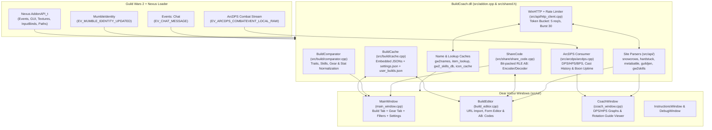

<p align="center">
  <a href="https://ko-fi.com/todd0042">
    
  </a>
</p>

---

# ⚔️ BuildCoach — Guild Wars 2 Nexus Build Advisor

[](https://github.com/Todd0042/BuildCoach/releases)
[-blue.svg)](https://github.com/Todd0042/BuildCoach)
[](CMakeLists.txt)
[-39ff14.svg)](src/hs_builds_embedded.h)
[](https://ko-fi.com/todd0042)

> **Compare your live Guild Wars 2 traits, skills, equipment stats, upgrades, and combat DPS against 573 bundled community builds (plus live URL imports and compact `AB:` share codes) directly inside your Nexus overlay.**

<p align="center">
  
</p>

---

## 📖 Table of Contents

* **Part 1 — User Overview & Quick Start**
  * [🛡️ What Is BuildCoach?](#-what-is-buildcoach)
  * [🚀 How BuildCoach Works in 3 Steps](#-how-buildcoach-works-in-3-steps)
  * [📸 Visual Tour](#-visual-tour)
  * [✨ Key Features at a Glance](#-key-features-at-a-glance)
  * [📦 Quick Start, Installation & Building from Source](#-quick-start-installation--building-from-source)
* **Part 2 — Technical Architecture & Reference**
  * [1. System Architecture & Nexus Addon Lifecycle (`src/addon.cpp`, `src/shared.h`)](#1-system-architecture--nexus-addon-lifecycle)
  * [2. Reference Build Sources, Bundled Payloads & Startup Cache (`src/build/cache.cpp`)](#2-reference-build-sources-bundled-payloads--startup-cache)
  * [3. Build Comparison Engine & Slot Normalization (`src/build/comparator.cpp`)](#3-build-comparison-engine--slot-normalization)
  * [4. Live Character Sync, GW2 API Client & Rate Limiter (`src/api/gw2api.cpp`, `src/api/api_rate_limiter.h`)](#4-live-character-sync-gw2-api-client--rate-limiter)
  * [5. ArcDPS Combat Telemetry, Rotation Guide Viewer & Skill Annotation (`src/arcdps/arcdps.cpp`, `src/ui/coach_window.cpp`)](#5-arcdps-combat-telemetry-rotation-guide-viewer--skill-annotation)
  * [6. Compact `AB:` Share Codes & In-Game Chat Detection (`src/share/share_code.cpp`, `src/addon.cpp`)](#6-compact-ab-share-codes--in-game-chat-detection)
  * [7. In-Game URL Parsers & Build Editor (`src/ui/build_editor.cpp`)](#7-in-game-url-parsers--build-editor)
  * [8. Settings, Persisted Cache Files & Controls (`src/ui/main_window.cpp`)](#8-settings-persisted-cache-files--controls)
  * [9. Build Scrapers, Offline Data Tools & `build.sh` CLI (`update_builds.sh`, `build.sh`)](#9-build-scrapers-offline-data-tools--buildsh-cli)
  * [10. Repository Structure & Verification (`CMakeLists.txt`)](#10-repository-structure--verification)
  * [11. AI Notice, Game Compliance & Support](#11-ai-notice-game-compliance--support)

---

# Part 1 — User Overview & Quick Start

## 🛡️ What Is BuildCoach?

**BuildCoach** (`v1.2.10`) is a native C++17 Guild Wars 2 overlay addon built for the **Nexus** addon loader. Instead of alt-tabbing to browser tabs to cross-check trait lines, gear stats, runes, sigils, relics, or skill priorities, BuildCoach brings your reference builds directly into the game.

It ships with **573 reference builds compiled right into `BuildCoach.dll`**—covering **Hardstuck** (`111` builds) and **MetaBattle** (`462` builds) across all **9 professions** and their elite specializations—and lets you import additional builds on demand from **Snow Crows**, **Hardstuck**, **GuildJen**, **MetaBattle**, and **gw2skills.net**, or share complete snapshots with squadmates using compact **`AB:` share codes**.

---

## 🚀 How BuildCoach Works in 3 Steps

1. **Install & Enable in Nexus**: Drop `BuildCoach.dll` into your Guild Wars 2 `addons/` folder and enable it in the Nexus addon manager. On first launch, optionally enter your GW2 API key (`characters`, `builds`, and `inventories` scopes) in the welcome prompt or **Settings** window.
2. **Pick or Import a Reference Build**: Filter the built-in catalog by **Profession**, **Build Type** (`Power`, `Condi`, `Support`, `Heal`, `Quickness`, `Alacrity`), **Source** (`Snow Crows`, `Hardstuck`, `MetaBattle`, `GuildJen`), **Game Mode** (`Group PvE`, `Raid`, `Open World`, `WvW Zerg`, `WvW Roaming`), or text search—or paste a community build URL into the **Build Editor**.
3. **Compare Live & Practice Your Rotation**: Switch between the **Build** and **Gear** tabs to spot mismatched specializations, traits, skills, stats, runes, sigils, relics, or consumables, and open the **DPS / Rotation** window for live ArcDPS damage/heal graphs alongside cached rotation guides.

---

## 📸 Visual Tour

<p align="center">
  
</p>

| Build & Gear Inspection | Comparison & Overlay Views |
| :---: | :---: |
|  |  |

<p align="center">
  
</p>

---

## ✨ Key Features at a Glance

* **📚 573 Reference Builds Ready Out of the Box**: Includes **111 Hardstuck builds** (`66` Group PvE, `28` Open World, `14` WvW Zerg, `3` WvW Roaming) and **462 MetaBattle builds** (`145` Raid, `135` WvW Roaming, `92` Open World, `90` WvW Zerg) embedded directly in the DLL and unpacked automatically on startup.
* **🔍 Multi-Axis Filtering & Search**: Narrow reference builds by Profession, Role/Build Type, Source site, Game Mode, or live substring search—with `[Custom]` builds and `[Accessibility]` builds grouped clearly at the top of the selector.
* **⚖️ Smart Build & Gear Comparison**:
  * **Traits & Skills**: Compares specialization lines regardless of slot order, validates major trait selections, matches heal/elite skills, and checks utility skills in any order (with name-based fallback for aliased skill IDs).
  * **Full Equipment Audit**: Compares armor, weapons (including two-handed offhand sigil synthesis), trinkets, backpiece, relic, food, and utility consumables. Automatically pairs interchangeable slots (`Ring1`/`Ring2`, `Accessory1`/`Accessory2`, and `WeaponA`/`WeaponB` sets) to avoid false-positive mismatches, and treats `Harrier's`, `Giver's`, and `Minstrel's` as equivalent support stats.
  * **Profession Mechanics**: Displays **Ranger pets** and **Revenant legends** for both player and reference builds.
* **🌐 Live URL Importer & Custom Build Editor**: Paste a build URL from **Snow Crows** (`snowcrows.com`), **Hardstuck** (`hardstuck.gg`), **GuildJen** (`guildjen.com`), **MetaBattle** (`metabattle.com`), or **gw2skills.net** (`en.gw2skills.net`) into the **Build Editor**, review or tweak the parsed gear/traits/skills, and save it to `user_builds.json`—or seed a new build from your currently equipped character.
* **📖 Interactive Rotation Guide & Live DPS/HPS Telemetry**: Open **DPS / Rotation** to view real-time ArcDPS fight-average DPS, 10-second rolling DPS, peak DPS, per-second damage graphs against the reference benchmark, Healing/Barrier per-second graphs (with ArcDPS Healing Stats support), and collapsible rotation guides fetched from Snow Crows, Hardstuck, MetaBattle, or GuildJen with inline skill icons and 6-week local disk caching.
* **🔗 Compact `AB:` Share Codes & Chat Auto-Detection**: Export any build as a bit-packed, URL-safe Base64 string (`AB:...`) small enough for squad chat or Discord. If the **Events: Chat** Nexus addon (`EV_CHAT:Message`) is installed, BuildCoach automatically shows a non-intrusive bottom-right toast whenever someone shares an `AB:` code so you can import it into the editor in one click.
* **✈️ Offline Mode & Rate-Limited GW2 API Integration**: Enforces a token-bucket limiter (`5 req/s`, burst `30`) on all `api.guildwars2.com` requests, caches resolved names/icons/specs by GW2 client build number, and offers an **Offline Mode** toggle that disables all GW2 API calls and relies solely on embedded builds and static lookup tables.

---

## 📦 Quick Start, Installation & Building from Source

### For Players (Prebuilt Addon)
1. Download `BuildCoach.dll` from [GitHub Releases](https://github.com/Todd0042/BuildCoach/releases).
2. Place `BuildCoach.dll` inside your Guild Wars 2 Nexus addons directory:
   ```text
   <Guild Wars 2>/addons/BuildCoach.dll
   ```
3. Launch Guild Wars 2 and enable **BuildCoach** in the Nexus addon manager.
4. Click the **BuildCoach** Quick Access icon (or bind a toggle key in Nexus under `KB_BUILDCOACH_TOGGLE`) to open the main window.
5. Open **Settings** and paste a GW2 API key with at least `characters`, `builds`, and `inventories` permissions so BuildCoach can fetch your equipped build automatically on map changes (or manually via **Refresh**).

> **Optional Companion Addons**:
> * **ArcDPS** (via Nexus): Enables live DPS/HPS/Barrier telemetry and per-second combat graphs in the **DPS / Rotation** window.
> * **Events: Chat** (`EV_CHAT:Message`): Enables automatic popup detection when `AB:` build share codes are posted in chat.

### Building from Source (Linux MinGW-w64 Cross-Compile)
BuildCoach compiles to a static-linked 64-bit Windows DLL (`BuildCoach.dll`) using CMake, Ninja, and `x86_64-w64-mingw32-g++` with all C++ dependencies (`Dear ImGui`, `Nexus` headers, `nlohmann/json.hpp`) vendored in [`external/`](external/):

```bash
# 1. Clone the repository
git clone https://github.com/Todd0042/BuildCoach.git
cd BuildCoach

# 2. Configure and build BuildCoach.dll into build/
./build.sh

# Optional: clean rebuild and install directly to your GW2 addons directory
./build.sh --clean --install="/path/to/Guild Wars 2/addons"
```

> **Note**: `./build.sh` compiles with `-DCMAKE_TOOLCHAIN_FILE=mingw-toolchain.cmake` in `Release` mode, links `winhttp` and `shell32` with `-static-libgcc -static-libstdc++` and static `winpthread`, and outputs `build/BuildCoach.dll`. See [Section 9](#9-build-scrapers-offline-data-tools--buildsh-cli) for `--regen` and build scraping workflows.

---
---

# Part 2 — Technical Architecture & Reference

> *The sections below document the verified implementation of BuildCoach `v1.2.10` directly from the repository source files.*

---

## 1. System Architecture & Nexus Addon Lifecycle

BuildCoach is structured as a single Nexus DLL ([`src/addon.cpp`](src/addon.cpp), [`src/addon.h`](src/addon.h)) backed by thread-safe shared state ([`src/shared.h`](src/shared.h)), modular HTTP/API clients (`src/api/`), a build cache & comparator (`src/build/`), an ArcDPS combat consumer (`src/arcdps/`), a bit-packed share code codec (`src/share/`), and a resolution-scaled Dear ImGui UI (`src/ui/`).



### DLL Lifecycle & Thread-Safe Shutdown ([`src/addon.cpp`](src/addon.cpp))
* **`GetAddonDef()`**: Exports `AddonDefinition_t` with signature `ADDON_SIGNATURE` (`(uint32_t)(-20250510)`), `NEXUS_API_VERSION`, version `1.2.10.0`, and GitHub update provider (`UP_GitHub` $\rightarrow$ `https://github.com/Todd0042/BuildCoach`).
* **`AddonLoad(AddonAPI_t* aApi)`**:
  1. Initializes WinHTTP (`Http::Init()`), resolves the addon directory (`APIDefs->Paths_GetAddonDirectory("BuildCoach")`), initializes `IconCache::Init()`, `BuildCache::SetCacheDir()`, `GW2Names::Init(BuildCache::LoadGW2Build())`, and `ItemLookup::Init()`.
  2. Registers `OnRender` (`RT_Render`) and `OnOptions` (`RT_OptionsRender`), subscribes to `EV_MUMBLE_IDENTITY_UPDATED` and `EV_CHAT_MESSAGE`, registers keybind `KB_BUILDCOACH_TOGGLE` (`""` default), loads embedded PNG textures (`src/icon_png.h`) for Quick Access (`QA_BUILDCOACH`), and calls `ArcDPS::Init()`.
  3. Defers Dear ImGui context binding (`ImGui::SetCurrentContext`, `SetAllocatorFunctions`) and `MainWindow::Init()` to the first `OnRender()` frame (`g_Initialized` lazy init).
* **`AddonUnload()`**:
  1. Sets `g_AddonShutdown = true` so `APIRateLimit::WaitAndAcquire()` and in-flight HTTP threads abort promptly.
  2. Deregisters all GUI callbacks, Nexus events, and keybinds **before** tearing down subsystem state.
  3. Joins all worker threads via `BuildEditor::Shutdown()`, `MainWindow::Shutdown()`, `CoachWindow::Shutdown()`, `GW2Names::Shutdown()`, `ArcDPS::Shutdown()`, and `Http::Shutdown()`.

---

## 2. Reference Build Sources, Bundled Payloads & Startup Cache

BuildCoach separates compiled-in reference payloads from runtime cache overrides so builds work immediately without network access while still supporting drop-in JSON updates.

### Embedded Payloads & Priority Order ([`src/build/cache.cpp`](src/build/cache.cpp))
On startup, `BuildCache::SetCacheDir()` writes embedded payloads into `<addon_dir>\cache\`:
* **Hardstuck (`src/hs_builds_embedded.h`)**: `111` builds (`hs_builds_json_len = 250,370` bytes) generated from `full-builds/hs_builds_full.json` after filtering out entries with `game_mode == "Unknown"`. Written to `cache\hs_builds_full.json`.
* **MetaBattle (`src/mb_builds_embedded.h`)**: `462` builds (`mb_builds_json_len = 1,113,343` bytes) generated from `mb-builds/mb_builds_full.json`. Written to `cache\mb_builds_full.json`.
* **Snow Crows (`src/sc_builds_embedded.h`, `src/sc_builds_offline.h`)**: Ships as empty arrays (`[]`) by default pending Snow Crows permission; `SetCacheDir()` skips overwriting `sc_builds_full.json` when `sc_builds_json_len <= 3` so any user-placed Snow Crows cache file is preserved.

When `BuildCache::LoadSCBuilds()` populates the dropdown, it loads builds per source in override order (deduplicating by `id` with per-profession files taking priority over combined files):
1. **Snow Crows**: `sc_builds_<prof>.json` $\rightarrow$ `sc_builds_full.json` $\rightarrow$ `sc_builds_accessibility.json` $\rightarrow$ `sc_builds.json` (fallback).
2. **Hardstuck**: `hs_builds_<prof>.json` $\rightarrow$ `hs_builds_full.json` (skipping `game_mode == "Unknown"`).
3. **MetaBattle**: `mb_builds_<prof>.json` $\rightarrow$ `mb_builds_full.json`.
4. **User Builds**: `user_builds.json` is loaded separately by `BuildEditor::Init()` and rendered under **Custom Builds** in the dropdown.

---

## 3. Build Comparison Engine & Slot Normalization

[`BuildComparator`](src/build/comparator.cpp) evaluates the live `GW2::PlayerBuild` against the active `GW2::SCBuild` across traits, skills, and gear ([`src/build/types.h`](src/build/types.h), [`src/build/comparator.h`](src/build/comparator.h)):

* **Traits (`CompareTraits`)**: Matches each non-empty reference specialization line (`spec_id`) against any of the player's 3 specialization slots (order-independent) and verifies all 3 major trait tiers.
* **Skills (`CompareSkills`)**: Validates Heal, Elite, and 3 Utility slots (utility order-independent). Matches by exact skill ID first, with a trimmed string-name fallback via `GW2Names::GetSkill()` to handle skill ID aliases (e.g., transformed or profession-variant skill IDs).
* **Gear & Consumables (`CompareGear`, `GearPanel::Render`)**:
  * **Interchangeable Slot Pairing (`normalize_pair`)**: Scores and swaps `Ring1`/`Ring2`, `Accessory1`/`Accessory2`, and `WeaponA`/`WeaponB` sets (mainhand + offhand moved as a unit; single-set references align to whichever player weapon set matches better).
  * **Two-Handed Weapon Synthesis**: Pulls `upgrade2_id` from equipped two-handed `WeaponA1`/`WeaponB1` slots into `WeaponA2`/`WeaponB2` in [`src/ui/gear_panel.cpp`](src/ui/gear_panel.cpp) so the second sigil is always compared.
  * **Support Stat Equivalence**: Normalizes `Harrier's`, `Giver's`, and `Minstrel's` to `"SUPPORT_EQUIV"` across all slots so healers/boon-supports are not flagged for equivalent toughness/concentration swaps.
  * **Weapon Type Normalization**: Folds aquatic API types (`"Harpoon"`, `"Trident"`) into `"Spear"` for land spear compatibility, backed by `src/api/weapon_type_db.h`.
  * **Relics & Consumables**: Resolves relics by canonical ID or fallback text name via [`src/api/relic_db.h`](src/api/relic_db.h) (handling dual-ID legendary/standard relics), plus food and utility buffs.

---

## 4. Live Character Sync, GW2 API Client & Rate Limiter

### Mumble Identity & Auto-Refresh ([`src/addon.cpp`](src/addon.cpp), [`src/ui/main_window.cpp`](src/ui/main_window.cpp))
* `OnMumbleIdentityUpdated` watches `MumbleIdentity` (`external/nexus/mumble.h`) for character `Name`, `Profession` (`1–9`), `Specialization`, and `MapID`.
* When `MapID == 0` (character select / login screen), stale `g_PlayerBuild` data is cleared immediately.
* On map changes or profession/spec changes, `MainWindow::Render()` schedules a background `GW2API::FetchFullPlayerBuild()` after a 5-second settle delay (with one automatic 5-second retry on failure).

### WinHTTP Client & Rate Limiter ([`src/api/http_client.cpp`](src/api/http_client.cpp), [`src/api/api_rate_limiter.h`](src/api/api_rate_limiter.h))
* All network requests run on background `std::thread` workers using WinHTTP (`Http::Get`, `Http::GetWithBearer`, `Http::GetPage`).
* `APIRateLimit` enforces a global token bucket targeting **$\le 5\text{ req/s}$** (`FILL_RATE = 5.0`, `CAPACITY = 30.0`, `LOW_MARK = 10.0`) on GW2 API calls; when tokens drop below `LOW_MARK` or requests are in flight, the UI displays *"Limited to reduce API usage to within reasonable bounds."*
* `GW2Names` ([`src/api/gw2names.cpp`](src/api/gw2names.cpp)) batches unresolved specialization, trait, skill, item, and stat IDs once per frame via `FlushPending()` and caches results to disk keyed by `g_GW2BuildNumber`, while `IconCache` ([`src/ui/icon_cache.cpp`](src/ui/icon_cache.cpp)) downloads `render.guildwars2.com` PNGs to `<addon_dir>\icons\` for `Textures_GetOrCreateFromFile`.

---

## 5. ArcDPS Combat Telemetry, Rotation Guide Viewer & Skill Annotation

### ArcDPS Combat Stream ([`src/arcdps/arcdps.cpp`](src/arcdps/arcdps.cpp), [`src/arcdps/arcdps_structs.h`](src/arcdps/arcdps_structs.h))
Subscribes to `EV_ARCDPS_COMBATEVENT_LOCAL_RAW` to track:
* **Damage & Healing Metrics**: Fight-average DPS, 10-second sliding-window DPS (`GetLast10SecDPS`), Peak DPS, per-second DPS history, plus HPS, Peak HPS, and Barrier/s (`GetHealHistory`, `GetBarrierHistory`, compatible with the ArcDPS Healing Stats addon).
* **Cast History, Boons & Build Detection**: Records `CastEvent` entries, tracks 10 core boon uptimes (`Aegis`, `Fury`, `Regeneration`, `Quickness`, `Alacrity`, `Might`, `Stability`, `Resolution`, `Vigor`, `Swiftness`), and listens for `CBTS_GWBUILD` statechange events to detect GW2 client patches.

### DPS / Rotation Window ([`src/ui/coach_window.cpp`](src/ui/coach_window.cpp))
Combines two live views in a dedicated popout window:
1. **Top Telemetry Pane (`RenderDpsPanel`)**: Toggleable **DPS** vs. **Heal/Barrier** modes with a custom `ImDrawList` per-second line graph, benchmark reference line, fight-average line, and interactive hover tooltips (`t=Xs`).
2. **Bottom Rotation Guide (`RenderSection`, `RenderRotationItem`)**:
   * Checks local `cache\sc_rotations_accessibility.json` first for accessibility builds; otherwise fetches rotation/priority sections from the build's `source_url` (`Hardstuck::FetchRotationPage`, `MetaBattle::FetchRotationPage`, `GuildJen::FetchRotationPage`, or `SnowCrows::FetchRotationPage`).
   * For MetaBattle prose rotations, [`GW2SkillsDB`](src/api/gw2_skills_db.cpp) loads per-profession skills (cached 30 days in `cache\gw2skills_<Profession>.json`, falling back to `/v2/skills?ids=all`) and annotates skill mentions with `{skill:ID}` markers so `CoachWindow` renders inline skill icons next to each step.
   * Caches parsed rotations under `<addon_dir>\cache\sc_cache\` for **6 weeks** (`max_age_hours = 1008`).

---

## 6. Compact `AB:` Share Codes & In-Game Chat Detection

[`ShareCode`](src/share/share_code.cpp) encodes an entire build into a short, URL-safe Base64 string prefixed with `AB:` using an LSB-first bit-stream (`BitWriter`/`BitReader`), Run-Length Encoding (`RLEEnc`/`RLEDec`), and compiled-in dictionary tables ([`src/share/dict_tables.h`](src/share/dict_tables.h)):

| Bitstream Section | Encoding Details |
| :--- | :--- |
| **Header** (`12` bits) | `version` (`4` bits: `v1` = 14 slots, `v2` = 16 slots), `flags` (`4` bits), `profession` (`4` bits, `1–9`) |
| **Traits** (`3 × 12` bits) | `spec_id` (`6` bits) + 3 major trait picks (`2` bits each; `0–2` or `3` = unset, resolved via `ItemLookup::SpecData`) |
| **Skills** (`5 × 18` bits) | Raw 18-bit GW2 skill IDs for Heal, Utility 1–3, and Elite |
| **Gear Stats** (`RLE`, `8`-bit index) | 16 gear slots mapped into `DICT_STAT` (`191` entries) |
| **Gear Upgrades** (`RLE`, `9`-bit index) | 16 gear slots mapped into `DICT_UPGRADE` (`361` runes + sigils) |
| **Weapons** (`4 × 5` + `18` bits) | 4 weapon type slots (`A1`, `A2`, `B1`, `B2`) + 2 reserved 9-bit upgrade fields |
| **Consumables** (`22` bits) | Relic (`8` bits, `DICT_RELIC` `206` entries with canonical name normalization), Food (`7` bits), Utility (`7` bits) |

* **Chat Build Detection ([`src/addon.cpp`](src/addon.cpp))**: When `g_ChatBuildDetection` is enabled and the **Events: Chat** addon emits `EV_CHAT_MESSAGE` across `Party`, `Squad`, `Whisper`, `Local`, `Map`, `Guild`, `PvP`, or `WvW` channels, BuildCoach scans for `AB:` tokens (`10–60` chars), pre-validates the version and profession bytes without blocking the game thread, and renders a bottom-right **BUILD SHARED** toast with a 1-click **Import to Editor** button.

---

## 7. In-Game URL Parsers & Build Editor

[`BuildEditor`](src/ui/build_editor.cpp) lets players create custom builds, clone their currently equipped character, import/export `AB:` codes, or fetch builds directly from any of 5 community sites:

| Site | Parser Module | Extracted Data |
| :--- | :--- | :--- |
| **Snow Crows** (`snowcrows.com`) | [`src/api/snowcrows.cpp`](src/api/snowcrows.cpp) | `data-armory-embed` specializations, skills, items, stats, upgrades, relic, consumables, game mode & rotation sections |
| **Hardstuck** (`hardstuck.gg`) | [`src/api/hardstuck.cpp`](src/api/hardstuck.cpp) | `<gw2object>` traits, skills, equipment containers (armor/weapons/trinkets/food), pets, legends, chat code & rotations |
| **MetaBattle** (`metabattle.com`) | [`src/api/metabattle.cpp`](src/api/metabattle.cpp) | Armory embeds (`specialization-embed-row`, `#skill_bar`, `#eq-box-1/2/3`, `#consumables`), runes, chat code & prose rotations |
| **GuildJen** (`guildjen.com`) | [`src/api/guildjen.cpp`](src/api/guildjen.cpp) | Traits, skills, gear stats (text + ID resolution), upgrades, relic, consumables & rotation guides |
| **gw2skills.net** (`en.gw2skills.net`) | [`src/ui/build_editor.cpp`](src/ui/build_editor.cpp) | Preload JS object (`qlink`), traits, skills, weapon types, and saved equipment stats/upgrades resolved against the gw2skills editor DB |

> **Tip**: `BuildEditor` auto-detects the site from the pasted URL (`StartAutoImport`), tags `source` and `game_mode` automatically, and persists saved builds to `<addon_dir>\cache\user_builds.json`.

---

## 8. Settings, Persisted Cache Files & Controls

### Controls & Nexus Registration
* **Quick Access**: Registered as `QA_BUILDCOACH` (`"Build Coach — Build Advisor"`) in the Nexus Quick Access bar.
* **Keybind**: Registered as `KB_BUILDCOACH_TOGGLE` (unbound by default; configure in Nexus Keybinds).
* **Resolution Scaling ([`src/ui/ui_scale.h`](src/ui/ui_scale.h))**: All UI dimensions scale dynamically relative to a `2560×1440` baseline, clamped between `0.5×` (`720p`) and `1.5×` (`4K`). Per-tab window sizes (`Build` default `700×844`, `Gear` default `1100×1271` at `1440p`) are saved automatically in `settings.json`.

### Settings (`<addon_dir>\settings.json`)
| Field | Type | Description |
| :--- | :--- | :--- |
| `api_key` | `char[73]` | Guild Wars 2 API key (`characters`, `builds`, `inventories` recommended) |
| `selected_build` | `char[128]` | Last selected reference build ID |
| `selected_boss` | `uint32_t` | Last selected Wingman boss ID |
| `auto_refresh` | `bool` | Auto-refresh build state |
| `last_gw2_build` | `uint64_t` | Last seen GW2 client build number (invalidates API caches on game patches) |
| `tab_width[3]` / `tab_height[3]` | `int[3]` | Saved per-tab window dimensions |
| `offline_mode` | `bool` | Disables GW2 API calls and relies on embedded reference builds & static lookup tables |
| `setup_complete` | `bool` | Marks the first-run welcome prompt dismissed |
| `chat_detect_own` | `bool` | Also trigger the `AB:` import toast on your own chat messages (for testing) |

### Runtime Cache Directory (`<addon_dir>\cache\`)
* `hs_builds_full.json`, `mb_builds_full.json`, `sc_builds_full.json`, `sc_builds_accessibility.json`, `sc_rotations_accessibility.json` — Embedded / override reference build and rotation payloads
* `user_builds.json` — User-created and URL-imported builds from **Build Editor**
* `sc_cache\` — Cached rotation pages (`1008`-hour / 6-week TTL)
* `gw2skills_<Profession>.json` — Per-profession skill dictionaries (`30`-day TTL) for MetaBattle rotation annotation
* Build-keyed GW2 API public data & name/icon resolution caches (`<addon_dir>\icons\` for downloaded CDN PNGs)

---

## 9. Build Scrapers, Offline Data Tools & `build.sh` CLI

### `./build.sh` Flags ([`build.sh`](build.sh))
| Flag | Behavior |
| :--- | :--- |
| *(none)* | Configures CMake with `mingw-toolchain.cmake` (Ninja if available), compiles `build/BuildCoach.dll` in `Release` mode |
| `--clean` | Deletes `build/` before configuring and compiling |
| `--regen` | Regenerates `src/sc_builds_embedded.h`, `src/sc_builds_offline.h` (via [`tools/embed_builds.py`](tools/embed_builds.py)), `src/mb_builds_embedded.h`, and `src/hs_builds_embedded.h` (filtering `game_mode == "Unknown"`) from JSON files before building |
| `--install` | Installs `BuildCoach.dll` to `$GW2_ADDONS_DIR/BuildCoach/BuildCoach.dll` |
| `--install=<path>` | Installs `BuildCoach.dll` to `<path>/BuildCoach/BuildCoach.dll` |

### `./update_builds.sh` & Scrapers ([`update_builds.sh`](update_builds.sh), [`SCRAPING.md`](SCRAPING.md))
Requires Python (`requests`, `beautifulsoup4`, `lxml`, `playwright` + Chromium):
```bash
# Re-scrape Snow Crows, Hardstuck, and MetaBattle, regenerate embedded headers, and rebuild DLL
./update_builds.sh

# Scrape a single source or single profession
./update_builds.sh --hs-only --prof guardian
./update_builds.sh --mb-only --force
```
* **Scrapers (`scraper/`)**: [`scrape_snowcrows.py`](scraper/scrape_snowcrows.py), [`scrape_hardstuck.py`](scraper/scrape_hardstuck.py), [`scrape_metabattle.py`](scraper/scrape_metabattle.py), [`scrape_rotations.py`](scraper/scrape_rotations.py), and [`build_weapon_db.py`](scraper/build_weapon_db.py).
* **Offline & Dictionary Tools (`tools/`)**: [`embed_builds.py`](tools/embed_builds.py), [`build_tables.py`](tools/build_tables.py) (builds `tools/dict_tables.json`), [`fetch_gw2_data.py`](tools/fetch_gw2_data.py), [`fetch_offline_data.py`](tools/fetch_offline_data.py), [`generate_offline_db.py`](tools/generate_offline_db.py), [`fix_pet_ids.py`](tools/fix_pet_ids.py), [`share_code_demo.py`](tools/share_code_demo.py), and [`DATA_INVENTORY.md`](tools/DATA_INVENTORY.md).

---

## 10. Repository Structure & Verification

```text
BuildCoach/
├── CMakeLists.txt               # C++17 MinGW DLL build configuration
├── build.sh                     # Cross-compile, header regeneration & deploy script
├── update_builds.sh             # End-to-end scraper + header regen + build runner
├── mingw-toolchain.cmake        # x86_64-w64-mingw32 CMake toolchain
├── SCRAPING.md                  # Scraping & embedded data documentation
├── external/                    # Vendored dependencies (no network required to compile)
│   ├── imgui/                   # Dear ImGui core sources
│   ├── nexus/                   # Nexus (nexus.h, Nexus.h) & Mumble (mumble.h) headers
│   └── nlohmann/json.hpp        # nlohmann/json single-header library
├── src/
│   ├── addon.cpp / .h           # Nexus DLL entrypoints, Mumble & chat event handlers
│   ├── shared.h                 # Global thread-safe state & logging helper
│   ├── *_embedded.h / offline.h # Auto-generated C arrays for Hardstuck, MetaBattle & SC builds
│   ├── api/                     # WinHTTP, rate limiter, GW2 API, Wingman & site parsers
│   ├── arcdps/                  # ArcDPS combat telemetry, boon tracking & cast history
│   ├── build/                   # Core build types, comparator & JSON/settings cache
│   ├── share/                   # Bit-packed RLE AB: share code encoder/decoder & dict tables
│   └── ui/                      # MainWindow, BuildPanel, GearPanel, CoachWindow, BuildEditor, etc.
├── scraper/                     # Python scrapers for Snow Crows, Hardstuck & MetaBattle
├── tools/                       # Dictionary generators, offline DB builders & share code demo
├── full-builds/                 # Hardstuck JSON datasets (source for hs_builds_embedded.h)
├── mb-builds/                   # MetaBattle JSON datasets (source for mb_builds_embedded.h)
└── icons/                       # Embedded gear-slot fallback PNG icons
```

### Build Verification
There is no automated unit-test suite in the repository. To verify compilation from source on Linux with `x86_64-w64-mingw32-g++`, `cmake`, and `ninja` (or `make`) installed:
```bash
./build.sh --clean
ls -lh build/BuildCoach.dll
```

---

## 11. AI Notice, Game Compliance & Support

### 🤖 AI Notice
This addon includes AI-generated content and/or AI-assisted code. AI may have been used during development for tasks such as code generation, suggestions, documentation, or content creation. While efforts are made to review and validate all AI-generated output, it may not always be fully accurate, optimal, or free of unintended behavior. Users should be aware that:
* AI-generated components may contain errors or inconsistencies or may be unstable,
* Behavior may change as the addon evolves or is updated,
* The developer remains responsible for ensuring compliance with the game's Terms of Service.

### ☕ Support Development
<p align="center">
  If BuildCoach helps you gear up faster and sharpen your rotations in Tyria, consider supporting development:<br/><br/>
  <a href="https://ko-fi.com/todd0042" target="_blank">
    
  </a>
</p>


## License

Copyright (c) 2026 [Todd0042](https://github.com/Todd0042). Source-available under the **[PolyForm Noncommercial License 1.0.0](LICENSE)**: free for personal, hobby, educational, research and nonprofit use. Commercial use (inside a company, in a paid product or service, or for profit) requires a separate license from [Todd0042](https://github.com/Todd0042). Third-party components keep their own licenses.

---

<p align="center">
  <a href="https://ko-fi.com/todd0042">
    
  </a>
</p>
